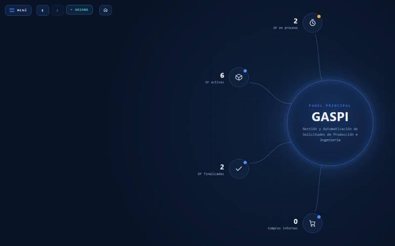
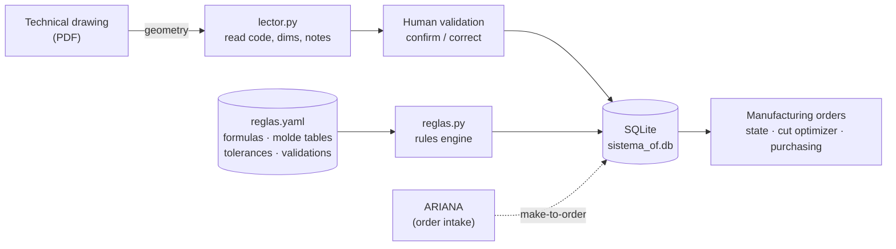

# GASPI — Manufacturing orders & a data-driven engineering rules engine



> The home view: GASPI at the center, with manufacturing orders in process,
> active and finished, plus internal purchasing requests.
> Built with Python · FastAPI · SQLite · a YAML-driven rules engine.

**GASPI** is the manufacturing side of a small production-engineering system I
built for the technical office of an industrial **filtration** company. It turns
a technical drawing (PDF) into a structured, calculated manufacturing order —
and it keeps the engineering know-how (formulas, molde tables, tolerances,
validations) in **one editable rules file** instead of hard-coded in the app.

It is the companion of [ARIANA](https://github.com/DifalcoTheo/ARIANA), the
order-intake system: when a purchase order is marked *make-to-order*, ARIANA
hands the job to GASPI, where Engineering assigns a lot number, uploads the
drawings and the job flows to Production.

> This is a **sanitized portfolio version** of a system in internal production.
> All company, client and employee names, prices, internal paths and IPs have
> been replaced with fictional data. **The proprietary molde weight tables were
> replaced with fictional values** — the structure and mechanism are real, the
> numbers are not. The demo runs entirely on generated sample data — no real
> drawings, database or mailbox required.

---

## The problem

The manufacturing know-how of the office lived in people's heads and in
spreadsheets: how a filter cartridge's sheet-metal structures develop when
unrolled, how much material each one consumes, which diameters can be produced,
what tolerances apply. Every order was re-calculated by hand from a drawing,
and the drawings themselves were inconsistent (decades of different templates).

GASPI does three things:

1. **Reads the drawing** — extracts code, dimensions and notes from a PDF using
   its *geometry*, not fixed positions, because geometry is the only thing
   consistent across old drawings. Whatever it can't resolve is flagged for a
   person, never guessed.
2. **Calculates and explains** — a rules engine computes every development,
   height and material consumption, and **always returns why** (which formula,
   which parameters), so an engineer can trust or correct it.
3. **Runs the shop floor** — manufacturing orders with per-line state
   (pending → in production → paused → finished), a cut optimizer, an internal
   purchasing view, and a comment/proposal loop between Production and
   Engineering. Every technical value is **frozen** into the order when it is
   launched, so a later edit to the product sheet never silently changes an
   order already in production.

## How it works



- **`reglas.yaml` is what the system executes.** Formulas and validation
  expressions are evaluated straight from the file by a small safe expression
  evaluator (numbers, variables and arithmetic only — no function calls, so a
  bad formula errors instead of running code). Change a number in the YAML and
  the calculation changes, with **no code change**. Every order records the
  rules *version* it was computed with, so an old order can always be
  re-explained with the rules that were in force that day.
- **The drawing reader (`lector.py`)** works on geometry: the code is the
  largest text at the top; the height is the single vertical dimension on the
  right edge; notes are grouped by the drawing's own measured line spacing.
  Each field it returns carries its origin and a confidence level.
- **Human-in-the-loop everywhere.** Nothing read from a drawing is saved on its
  own; nothing calculated overrides what a person confirmed.

## Tech stack

- **Python** — FastAPI (REST API + static UI), standard-library `sqlite3`,
  **PyMuPDF** for PDF geometry extraction, **PyYAML** for the rules file.
- **SQLite** — single-file database; schema in `esquema.sql`, FTS5 full-text
  search over the product library.
- **A data-driven rules engine** — the interesting part: `reglas.py` executes
  `reglas.yaml`. No formula is written in the Python.
- **Vanilla HTML/CSS/JS** — one server-rendered single-page UI, no framework.
- Runs on **Windows / local network** in production; the demo runs anywhere
  Python does.

## Run the demo (no drawings, no real data)

```bash
pip install -r requirements.txt
python seed_demo.py      # builds datos/sistema_of.db from the fictional sample data
python app.py            # http://127.0.0.1:8000
```

Login (generated on first run): **ingenieria** / **produccion** / **compras** —
password **changeme**.

`seed_demo.py` loads the molde tables from `reglas.yaml` through the **real**
engine, then inserts 12 fictional filter-cartridge product sheets and 8
manufacturing orders. Open a product to see the calculated developments with
their explanations, or an order to see its frozen technical data, the cut
optimizer and the per-line state.

## Repository layout

```
app.py             FastAPI server: search, product sheet, orders, cut optimizer, purchasing, comments
reglas.yaml        THE RULES: parameters, formulas, molde tables, filter media, synonyms, validations
reglas.py          Rules engine: executes reglas.yaml (no formula written in Python) + cut optimizer
lector.py          Reads a drawing PDF by geometry; returns each field with origin + confidence
esquema.sql        SQLite schema (product / lote / linea / plano / molde / comentario / historial / FTS)
importar.py        One-time legacy migration (reference; not used by the demo)
mailer.py          Optional e-mail notifications (SMTP) — dormant until configured
seed_demo.py       One-command demo: builds the DB from sample_data/
sample_data/       Fictional products, orders and in-process jobs for the demo
web/index.html     Server-rendered single-page UI (per-line tabs: General, Seals, Others, Metallurgy, Media, Purchasing, Production)
```

## Notes

- **Configuration** — role passwords and paths ship with placeholders
  (`changeme`); credentials are hashed (PBKDF2) into a file generated on first
  run and never committed.
- **Sanitized** — the molde weight tables in `reglas.yaml` are fictional; the
  real drawings, the production database and the legacy migration source are not
  part of this repo (see `.gitignore`). The intake pipeline, the rules engine
  and the whole UI are fully runnable from the sample data.
- **E-mail notifications** (`mailer.py`) — when an order is sent to production,
  the team is notified by e-mail (SMTP, with retry and draft-on-failure). It is
  **dormant** until `datos/notificaciones.json` is configured, so the demo never
  sends anything; the credentials file is git-ignored.
- **Per-medium support** — a filter can carry several filtration media, each with
  its own form (pleated or rolled) and its own development formula; seals are read
  per end (upper/lower).
- Built and maintained solo, in production use by Engineering, Production and
  Purchasing.
